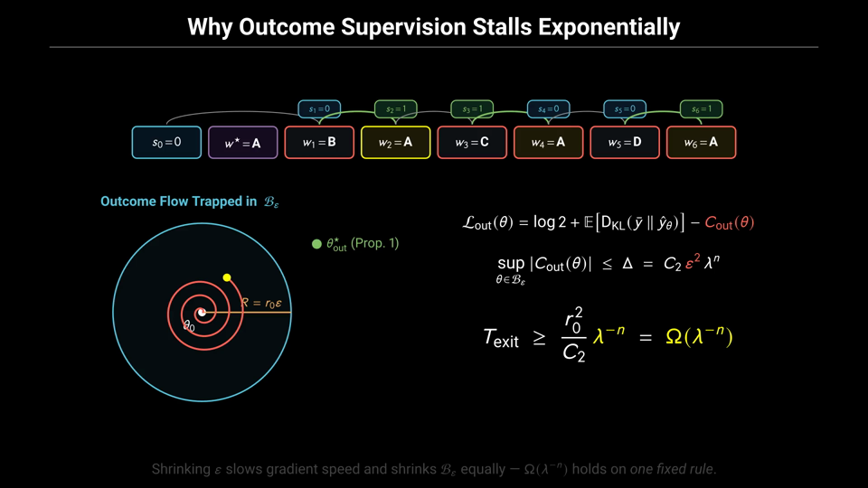
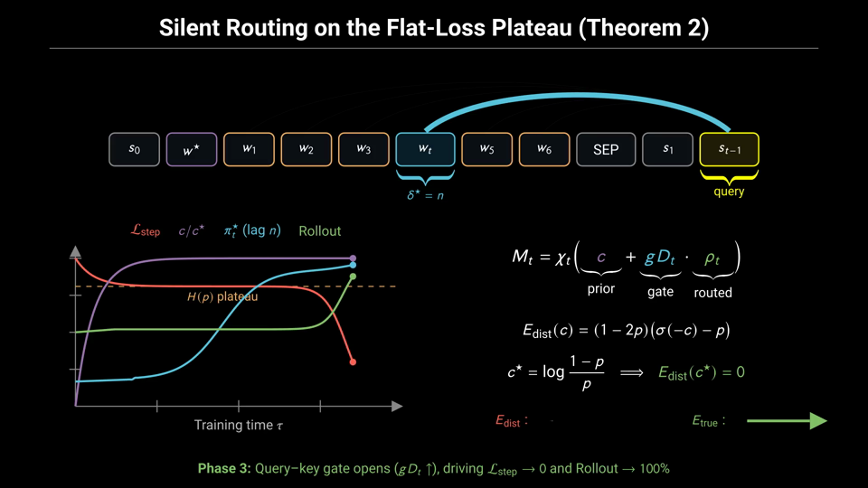

# Trace — Silent Routing

Code and explainer animations for **Silent Routing: How Step Supervision Trains Transformers Where Outcome Supervision Stalls** (ICML 2026).

<p align="center">
  
</p>

## Explainer Animations

Full 56s walkthrough (1080p60): [`animations/00_full_explainer.mp4`](animations/00_full_explainer.mp4) ([Manim source](animations/scenes.py))

<table>
  <tr>
    <td align="center" width="33%">
      <a href="animations/01_outcome_plateau.mp4"></a><br />
      <a href="animations/01_outcome_plateau.mp4"><strong>1. Outcome Plateau</strong></a>
    </td>
    <td align="center" width="33%">
      <a href="animations/02_silent_routing.mp4"></a><br />
      <a href="animations/02_silent_routing.mp4"><strong>2. Silent Routing</strong></a>
    </td>
    <td align="center" width="33%">
      <a href="animations/03_stateless_block_rms.mp4"></a><br />
      <a href="animations/03_stateless_block_rms.mp4"><strong>3. Stateless Block-RMS</strong></a>
    </td>
  </tr>
</table>

## Quickstart

```bash
uv sync
uv run python two_block/counting.py task=count word_len=6 mod=2 steps=8000  # Python smoke test
make -C cpp all check                                                        # C++20 suite + grad check
```

## Layout

| Path | Contents |
|---|---|
| [`animations/`](animations/README.md) | Manim source, 4 rendered 1080p60 MP4s, and README previews |
| [`cpp/`](cpp/README.md) | C++20 27-block causal interventions, Block-RMS SGD, and `(Step-ODE)` solver |
| [`two_block/`](two_block/README.md) | Two-block Transformer (`counting.py`), exact executors, plateau checks, demo notebook |
| `src/`, `configs/`, `data/` | GPT-2L and LoRA transfer experiments (Boolean-8, register machine, BBH) |

Full reproduction commands are in [RUN.md](RUN.md).

## Citation & License

```bibtex
@inproceedings{silentrouting2026,
  title     = {Silent Routing: How Step Supervision Trains Transformers Where Outcome Supervision Stalls},
  author    = {Anonymous Authors},
  booktitle = {International Conference on Machine Learning (ICML)},
  year      = {2026}
}
```

Released under the [MIT License](LICENSE).
