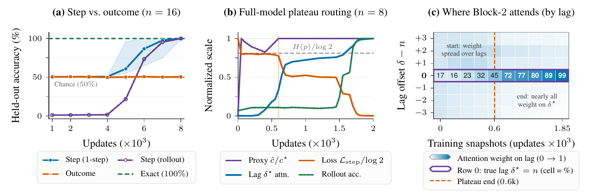
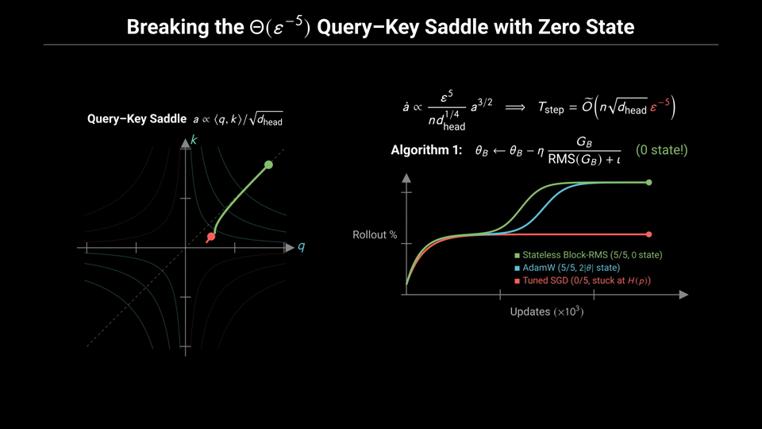

# Trace — Silent Routing

Code, C++20 verification suite, Manim explainer animations, and LaTeX sources for:

> **Silent Routing: How Step Supervision Trains Transformers Where Outcome Supervision Stalls** (ICML 2026)

<p align="center">
  
</p>

*One task, one two-block Transformer, one dynamical separation.* Under outcome-only supervision, unread state transitions damp gradients exponentially in sequence length $n$, trapping full-model gradient flow near uniform predictions for $\Omega(\lambda^{-n})$ time ($\lambda = |1-2p|$). Under step supervision, the linear readout fits a state-only baseline at binary entropy $H(p)$ that cancels residual correlation with all $n-1$ wrong prefix letters, letting Block-2 attention lock onto the true lookback lag $\delta^\star = n$ while the loss stays flat (**silent routing**). Stateless **Block-RMS SGD** then removes the $\Theta(\varepsilon^{-5})$ query–key saddle bottleneck with zero optimizer state.

---

## Artifacts

### Paper

| Artifact | Path | Description |
|---|---|---|
| **Compiled Paper (PDF)** | [`papers/silent_routing/main.pdf`](papers/silent_routing/main.pdf) | Full 55-page ICML 2026 manuscript (main text + Appendices A–G) |
| **LaTeX Sources & Figures** | [`papers/silent_routing/`](papers/silent_routing/) | Self-contained `main.tex`, `body.tex`, `appendix.tex`, `main.bib`, and TikZ/PGFPlots `figures/` |

### Explainer Animations (1080p60 Manim)

Watch the full combined walkthrough: **[`00_Silent_Routing_Full_Explainer.mp4`](animations/00_Silent_Routing_Full_Explainer.mp4)** *(56s, 1080p60)* — or jump to any scene below (click a preview to open the video):

<table>
  <tr>
    <td align="center" width="33%">
      <a href="animations/01_Outcome_Plateau.mp4">
        
      </a><br />
      <strong>1. Outcome Plateau</strong> (20s)<br />
      <a href="animations/01_Outcome_Plateau.mp4"><code>01_Outcome_Plateau.mp4</code></a><br />
      <sub>Shared expressivity &amp; the $\Omega(\lambda^{-n})$ barrier (Thm. 1)</sub>
    </td>
    <td align="center" width="33%">
      <a href="animations/02_Silent_Routing.mp4">
        
      </a><br />
      <strong>2. Silent Routing</strong> (22s)<br />
      <a href="animations/02_Silent_Routing.mp4"><code>02_Silent_Routing.mp4</code></a><br />
      <sub>Baseline cancellation $E_{\mathrm{dist}}(c^\star)=0$ &amp; lag-$n$ locking (Thm. 2)</sub>
    </td>
    <td align="center" width="33%">
      <a href="animations/03_Stateless_Block_RMS.mp4">
        
      </a><br />
      <strong>3. Stateless Block-RMS</strong> (15s)<br />
      <a href="animations/03_Stateless_Block_RMS.mp4"><code>03_Stateless_Block_RMS.mp4</code></a><br />
      <sub>$\Theta(\varepsilon^{-5}) \to \Theta(\varepsilon^{-2})$ gate escape with 0 state (Thm. 3)</sub>
    </td>
  </tr>
</table>

Manim source and build instructions live in [`animations/`](animations/README.md) ([`silent_routing_scenes.py`](animations/silent_routing_scenes.py)).

### Code & Verification Suites

| Component | Path | What it covers |
|---|---|---|
| **C++20 Causal Intervention Suite** | [`cpp/`](cpp/README.md) | Cross-platform (macOS Accelerate / Linux CBLAS shim) 27-block Transformer engine for all baseline-projection ($\Pi_0$), external-offset, and Stateless Block-RMS experiments (Fig. 3–4, Table 1–2a), float64 gradient checker, and `(Step-ODE)` solver |
| **Python Counting & Theory Checks** | [`handcoded/`](handcoded/README.md) | Two-block Transformer (`lettertrace.py`), exact executors (Prop. 1), float64 outcome-plateau exit times (Thm. 1 / Table 5), counting/spectrum sweeps (Fig. 1a, Tables 6–8), and verification scripts |
| **Automata & LLM Transfer** | [`src/`](src/) | Character-token GPT-2L (Boolean-8 $A_{16}$, mod-17 register machine), rank-8 LoRA (SmolLM2-135M, Qwen2.5-0.5B), and BIG-Bench Hard tracking shuffled objects |

---

## Quickstart

```bash
# 1. Python environment & counting smoke test (two-block Transformer, n = 6, mod 2)
uv sync
uv run python handcoded/lettertrace.py task=count word_len=6 mod=2 steps=8000

# 2. Build the C++20 causal intervention suite and run the float64 finite-difference gradient check
make -C cpp all check

# 3. Compile the paper PDF (requires tectonic)
cd papers/silent_routing && tectonic -X compile main.tex
```

Full commands to reproduce every figure, table, and numerical claim are in **[RUN.md](RUN.md)**.

---

## Repository Layout

```text
trace/
├── papers/
│   ├── README.md                    Build instructions for the paper
│   └── silent_routing/              ICML 2026 paper: main.tex, body.tex, appendix.tex, main.bib, figures/, main.pdf
├── animations/
│   ├── README.md                    Manim render & concatenation guide
│   ├── silent_routing_scenes.py     Manim source for all three explainer scenes
│   ├── 00_Silent_Routing_Full_Explainer.mp4
│   ├── 01_Outcome_Plateau.mp4
│   ├── 02_Silent_Routing.mp4
│   ├── 03_Stateless_Block_RMS.mp4
│   └── previews/                    PNG previews embedded in this README
├── cpp/
│   ├── README.md                    Build, gradient-check, and sweep instructions
│   ├── Makefile                     Auto-detects macOS Accelerate vs. Linux g++ + cblas_shim.h
│   ├── run_full_plan.cpp            Unconstrained 27-block Transformer & all 11 intervention/optimizer modes
│   ├── shortcut_intervention.cpp    Float64 reference & finite-difference gradient verifier
│   ├── step_ode_suite.cpp           Float64 population (Step-ODE) verification suite
│   ├── run_causal_fast.cpp          Batched float32 training & rollout engine
│   ├── run_causal_sweep.cpp         Parameter sweep driver
│   ├── aggregate_results.cpp        Pure C++20 multi-seed CSV aggregator
│   └── analysis/                    aggregate.py (Table 1 / Wilson CIs / Fisher tests), make_causal_fig.py, summary.json
├── handcoded/
│   ├── README.md                    Paper-to-code map for all Python two-block scripts
│   ├── lettertrace.py               Counting task, exact executors (Prop. 1), step/outcome training
│   ├── regime_both.py               Float64 population GD outcome-plateau exit times (Thm. 1, Table 5)
│   ├── experiments/                 sweeps.py (Fig. 1a, Table 6, lambda grid), measure.py (spectra, ANOVA, untied routing),
│   │                                seeded_sweep.py, init_scale_sweep.sh (Table 7), plateau_spectra.sh
│   └── checks/                      executor_check.py (Prop. 1), credit_checks.py (App. C & G.3), log_claims.py (Tables 6–7)
├── src/                             Character-token GPT-2L, LoRA (SmolLM2 / Qwen2.5), BIG-Bench Hard
├── configs/experiments/             YAML experiment configs for src/
├── data/bbh/                        Official BIG-Bench Hard tracking shuffled objects items (unchanged)
├── results/, logs/, ckpt/           Local experiment outputs and checkpoints (gitignored)
├── RUN.md                           End-to-end reproduction guide
└── run.sh                           One-command Python smoke test
```

> **Note:** `src/`, `configs/`, and `data/` must remain siblings at the repository root; the Python modules resolve them relative to the repo root.
